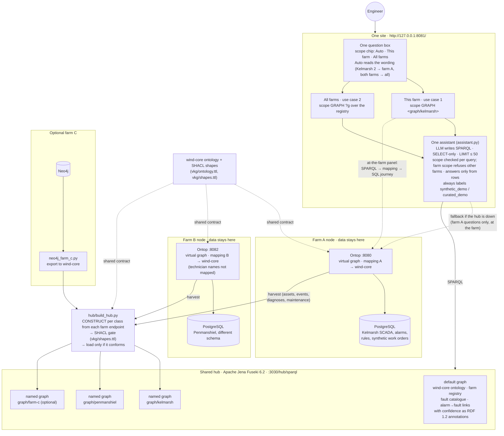

# Wind-energy knowledge graph: one hub, one site, use cases 1 and 2

A standards-based knowledge graph over open wind-farm SCADA data, following Kwakye & Barber (2026) and the *Game Plan* in this folder. The steps of the paper map onto the stack like this:

1. **Sources.** Each farm keeps its data in its own database (PostgreSQL), in its own local layout.
2. **Shared ontology and mappings.** Each farm maps its tables to the shared **wind-core** vocabulary (`vkg/ontology.ttl`) with one Ontop mapping.
3. **Virtual layer per farm.** **Ontop** publishes each farm as a virtual RDF graph. Nothing is copied at the farm.
4. **Validation.** Every farm graph must pass the wind-core **SHACL** shapes (`vkg/shapes.ttl`) before it enters the hub.
5. **Hub.** One **Apache Jena Fuseki 6.2** endpoint holds **one named graph per farm** plus the shared curated knowledge: the fault catalogue and the alarm-to-fault links with their confidence as **RDF 1.2 annotations**.
6. **Assistant.** One LLM assistant (Gemini by default, Groq works) turns plain-English questions into read-only SPARQL **against the hub only** and answers only from the returned rows.

**One site, one question box** at **http://127.0.0.1:8081/**. Type a question; the scope is detected from its wording, or pick it with the scope chip:

| Scope chip | Use case | What the assistant may read on the hub |
| --- | --- | --- |
| Auto (default) | 1 or 2 | decided from the question: "Kelmarsh 2 …" or no farm named means farm A; "both farms", "each farm", "across all farms" or another farm's name (Penmanshiel, farm B/C) means all farms |
| This farm | 1, fault diagnosis | `GRAPH <https://w3id.org/wind-core/data/graph/kelmarsh>` only, plus the shared curated knowledge |
| All farms | 2, cross-farm learning | every farm graph (`GRAPH ?g`, bound from the farm registry), plus the shared curated knowledge |

The page shows which scope was used and why, and offers example chips for both use cases. **Privacy:** data stays at the farm (each farm publishes only through its own Ontop endpoint); only the validated hub is shared, and the page says so. The safety rule is unchanged and enforced in code: a *This farm* question that names another farm is refused before the LLM is called, and every generated farm-scoped query is checked to stay inside farm A's graph. Services still fail independently: the page shows one status line for farm A questions and one for all-farms questions; if the hub is down, farm A questions are answered **at the farm**, on farm A's own Ontop endpoint, and say so, while all-farms questions report that the hub is unavailable. A collapsed **"At the farm"** panel keeps raw SPARQL on farm A's Ontop endpoint with the query journey (SPARQL → mapping → Ontop SQL → PostgreSQL), and every farm A answer has a button that replays the same question there.

| Service | Where | Data |
| --- | --- | --- |
| Site (one question box, one assistant) | http://127.0.0.1:8081/ | |
| Hub (Fuseki) | http://127.0.0.1:3030/hub/sparql | default graph: ontology, farm registry, fault catalogue, RDF 1.2 alarm→fault knowledge; named graphs `.../data/graph/{farm}` |
| Farm A node (Kelmarsh, 6 turbines) | PostgreSQL `db` → Ontop :8080 | real 2016 SCADA + alarms; curated rules; 10 synthetic work orders |
| Farm B node (Penmanshiel, 14 turbines) | PostgreSQL `db-b` → Ontop :8082 | real 2016 SCADA + alarms; synthetic work orders; *different local schema* |
| Farm C (optional, Neo4j) | Neo4j :7474 → exported into the hub | the team lead's fictional Cypher example |

Architecture (source: [docs/architecture.mmd](docs/architecture.mmd); GitHub and VS Code render the block below):



### How a farm gets into the hub

`hub/build_hub.py` asks each farm's Ontop endpoint for its published records with one SPARQL `CONSTRUCT` per class (farms, turbines, components, events, diagnoses, maintenance, technicians, parts, logs, datasets, event instants), validates the result with SHACL (RDFS inference on), and writes the farm's named graph only if it conforms. The farm registry in the hub's default graph records, for each farm, its endpoint, its graph, when it was harvested (`wind:harvestedAt`) and how many triples it has. If a farm endpoint is down during a rebuild, the farm's last validated snapshot is kept, so one farm being down never empties the hub. A farm that fails SHACL is not loaded; the report is written to `build/hub/farms/<farm>.shacl-report.txt`.

The **SCADA time series stay at the farm**: observations are not harvested. Ask them on the farm's own endpoint (the "At the farm" panel, or http://127.0.0.1:8080/sparql). The hub holds a validated copy of the *published, non-time-series* part of each farm graph; the farm databases remain the source of truth, and the hub is refreshed by re-running the build:

```powershell
uv run --with rdflib --with pyshacl python hub/build_hub.py   # harvest + SHACL check every farm (about 2 minutes)
docker compose restart hub
```

## Run

Prerequisites: Docker Desktop running, `uv` with Python 3, the pgJDBC JAR at `cli/jdbc/postgresql-42.7.14.jar`, the Kelmarsh files in `data/kelmarsh/`. Optional: the Penmanshiel files in `data/penmanshiel/` (see its README; do not unzip), and an LLM key.

1. Copy `.env.example` to `.env` and set `LLM_API_KEY=...` (free key from aistudio.google.com). For Groq, also set `LLM_BASE_URL=https://api.groq.com/openai/v1` and a Groq `LLM_MODEL`. `.env` is git-ignored. The free tiers are rate limited; the assistant waits and retries on HTTP 429.
2. From PowerShell in this folder: `.\setup.ps1` (add `-Neo4j` to include farm C). On Linux/macOS: `./setup.sh [--neo4j]`.

Setup rebuilds **only** the demo tables in the two demo databases; the source files are never modified. Order: farm databases → farm Ontop endpoints → hub build (harvest + SHACL) → hub + site. Farm B starts automatically when the Penmanshiel files are present. Stop with `docker compose --profile uc2 --profile neo4j stop`. `down -v` deletes the imported databases.

Checks (with the services running):

```powershell
uv run --offline python run_demo.py --verify --benchmark   # farm A at the farm: SPARQL on Ontop = SQL, counts, timing
uv run --offline python run_hub.py --verify                # hub: use case 1 on farm A's graph = SQL on farm A; use case 2 = SQL on both farms
uv run --offline python test_workbench.py                  # site: single question box, per-scope status, hub queries, farm A journey
uv run --offline python test_assistant.py                  # assistant with a fake LLM: scopes and auto-detection, retry, hub = farm, hub-down fallback, unsafe queries
uv run --with rdflib --with pyshacl python check_graph.py  # ontology + SHACL check of farm A's endpoint
uv run --with rdflib --with pyshacl python check_graph.py http://127.0.0.1:8082/sparql farm_b/mapping.obda   # farm B
```

## The two use cases

**Use case 1, fault diagnosis (This farm scope).** Ask *"What usually causes high gear bearing temperature on a gearbox, and what fixed it last time?"*. The LLM writes SPARQL like [queries/farm_a_01_fault_diagnosis.rq](queries/farm_a_01_fault_diagnosis.rq), which runs on the hub inside farm A's graph; `run_hub.py --verify` checks it returns exactly what SQL on farm A's database returns. [queries/05_uc1_fault_diagnosis.rq](queries/05_uc1_fault_diagnosis.rq) is the same question at the farm, on Ontop. The alarms are real Kelmarsh events ("High temp. gear bearing 2" on Kelmarsh 2, January 2016); the alarm-to-fault confidences are illustrative demo rules (`curated_demo`); the repairs are synthetic (`synthetic_demo`). The page and the assistant's reply label each.

**Use case 2, cross-farm learning (All farms scope).** Ask *"For gearbox faults, how did each farm fix them and how often?"*. It is the same pattern as use case 1, over every farm graph. Saved hub queries:

- [hub_01_cross_farm_fixes.rq](queries/hub_01_cross_farm_fixes.rq): the team lead's query, fixed so repairs are linked to the fault they address and counted `DISTINCT`, across all farm graphs.
- [hub_02_alarm_knowledge.rq](queries/hub_02_alarm_knowledge.rq): RDF 1.2 edge annotations (`?type wind:suggestsFault ?f {| wind:confidence ?c |}`) joined with alarm counts from each farm graph.
- [hub_03_governance.rq](queries/hub_03_governance.rq): what each farm publishes and withholds, and when the hub last harvested it. Farm B never mapped `work_orders.crew_name`, so technician names cannot be reached through the graph.
- [hub_04_three_farms.rq](queries/hub_04_three_farms.rq) (needs `-Neo4j`): the Neo4j farm answers the same question in the same vocabulary from its own named graph.

Repair differences between farms come from **synthetic** work orders, designed to illustrate the query. They are not findings.

## Where things live

| Thing | File(s) | Stored? |
| --- | --- | --- |
| Shared vocabulary (classes, relations, attributes) | `vkg/ontology.ttl` (wind-core, namespace `https://w3id.org/wind-core/ontology#`, to be registered) | text |
| Conformance rules every farm must pass | `vkg/shapes.ttl` (SHACL), run by `check_graph.py` | text |
| Farm A facts | PostgreSQL volume `vkg_pgdata`, schema `db/schema.sql`, loaded by `prepare_data.py` + `db/load.sql` | **yes** |
| Farm A relations (how rows become edges) | `vkg/mapping.obda` → generated `vkg/mapping.ttl` (R2RML, used at runtime) | text |
| Farm B facts / relations | volume `farmb_pgdata`, `farm_b/schema.sql`, `prepare_farm_b.py`, `farm_b/mapping.obda` → `farm_b/mapping.ttl` | **yes** / text |
| Curated fault knowledge | `data/curated/fault_conditions.csv`, `alarm_fault_rules.csv` → farm tables *and* `hub/build_hub.py` → hub default graph (RDF 1.2) | text |
| Farm registry (endpoint, harvest endpoint, governance) | `hub/farms.csv` | text |
| Hub dataset | `hub/build_hub.py` → `build/hub/hub.trig` (default graph + one named graph per farm); validated farm snapshots in `build/hub/farms/` | **yes** (rebuilt) |
| Assistant | `assistant.py` (one assistant; per-scope prompt built from `ontology.ttl` + `queries/farm_a_*.rq` or `queries/hub_0[123]_*.rq`) | |
| Site | `query_workbench.py` + `workbench.js` (one question box, `/status` per scope, at-the-farm journey) | |

IRIs follow one template per entity type, farm-scoped: `https://w3id.org/wind-core/data/farm/{farm}/turbine/{id}`, `.../event/{row}`, `.../component/{Gearbox|Generator}`. Faults are shared across farms: `https://w3id.org/wind-core/data/fault/{FaultCode}`.

**Add a relation or attribute:** declare it in `vkg/ontology.ttl` (with `rdfs:comment`, and domain/range for object properties); make sure the value is in PostgreSQL (`db/schema.sql`, `prepare_data.py`); add it to a `target` in `vkg/mapping.obda` reusing the IRI templates; regenerate R2RML (`cli\ontop.bat mapping to-r2rml -i vkg/mapping.obda -o vkg/mapping.ttl --force`, or `docker run --rm -v ${PWD}/vkg:/input --entrypoint /opt/ontop/ontop ontop/ontop:5.5.0 mapping to-r2rml -i /input/mapping.obda -o /input/mapping.ttl --force`); restart Ontop; add a `.rq` + `.sql` pair to `queries/` and to `NAMES` in `run_demo.py`. For a new SCADA signal you only extend the `measurement_observations` and `logical_sensors` views; the observation mapping is generic. Repeat in `farm_b/` for farm B.

**Add a class (object type):** declare it in the ontology (e.g. `rdfs:subClassOf wind:Component`), add a table or view and its loader (`schema.sql`, `prepare_data.py`, and the `TRUNCATE`/`COPY` lines in `load.sql`), add a `mappingId` block, add a SHACL shape, regenerate, restart, test.

**Add a farm:** load its data in any SQL layout, write one mapping to wind-core, run `check_graph.py` against its endpoint, add a row to `hub/farms.csv` (with the endpoint the hub can reach for harvesting), rebuild the hub. It appears as a new named graph and in All-farms answers without code changes.

## Data honesty and governance

Every record carries `wind:recordKind` and `prov:wasDerivedFrom` a `wind:Dataset` with source, owner, licence and usage note: `observed_source` (Cubico SCADA and alarms), `curated_demo` (illustrative rules and confidences), `derived_assumption` (one gearbox and one generator per turbine, from the model), `synthetic_demo` (all work orders, technicians, parts and logs). The assistant always says so in its reply when synthetic records are involved (it adds the sentence itself if the model leaves it out), and the page shows the labels. All ports are bound to `127.0.0.1`. Before any remote use: read-only database roles per farm, an authenticated proxy in front of each endpoint, and access decided per dataset.

Not shown by this demo: real repairs or root causes, OWL reasoning beyond OWL 2 QL, or more than one year of data. Ontop does not emit RDF 1.2 triple terms, so edge annotations live in the hub's default graph, while farm graphs carry the same confidence on `wind:Diagnosis` nodes. The hub's farm graphs are snapshots: rebuild the hub after farm data changes (the registry shows each harvest time).
