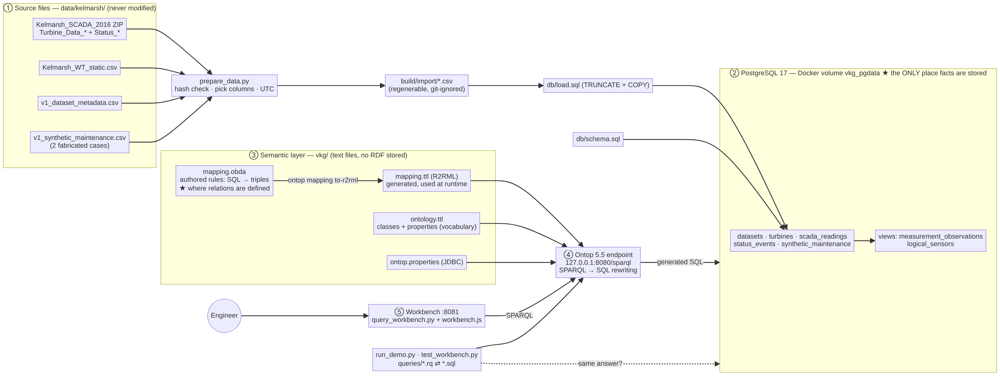
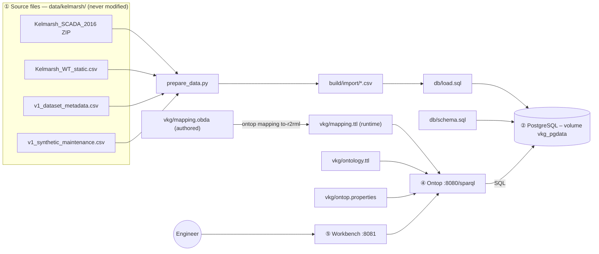
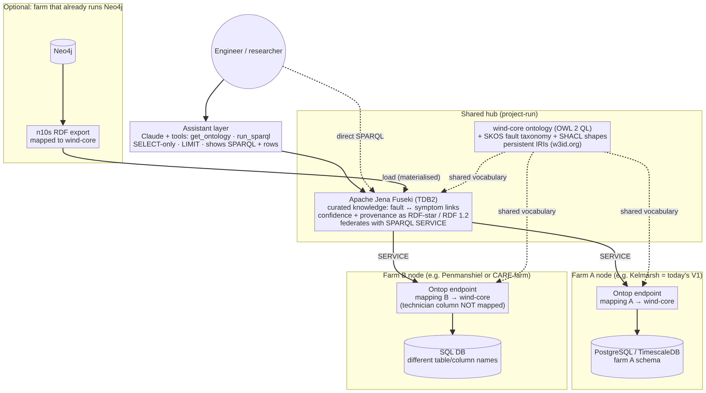

# Wind-Energy KG: plan review, V1 architecture, and recommended stack

Draft for discussion, 13 Nov 2026. Covers: (A) is the Game Plan sound and does V1 match it, (B) how V1 is built and how to extend it, (C) one recommended stack and how the lead's two use cases fit on it, (D) open questions.

Diagrams: `architecture_v1.png` (what exists today) and `architecture_target.png` (recommended V2). Mermaid sources are inline below and in the `.mmd` files.

---

## TL;DR

1. **The Game Plan is sound.** Its key calls are correct and still true today: Ontop only reads SQL sources, mainline Ontop has no RDF-star, and Neo4j should only come in for a measured workload. Three things need updating: "RDF-star" is now **RDF 1.2** (W3C Candidate Recommendation, April 2026), the **LLM assistant should move from V3 to V2** because the pitch depends on it, and V1 needs a small **V1.1 clean-up** before going multi-farm. The main gaps are hard-coded farm, farm-less IRIs, gear-oil temperature loaded but unmapped, and faults modelled per case instead of as types.
2. **V1 matches the plan** on steps 0–5 and most of 6. The only unproven item is plan step 2 ("reasoner reports consistent"): there is no evidence of a HermiT/Protégé check, and the ontology has no domain/range axioms.
3. **Your instinct about the lead's stack is right, but only on one point.** The use-case *stories* are good. The *stack* breaks in one specific place: UC2 says "Farm A (Neo4j) … Ontop lets people query the data in place". Ontop cannot do that, because it only reads relational and SQL-speaking sources. To be fair, the paper itself (§4.1.1) says OBDA can expose "LPGs, time-series databases", so the lead copied a claim the paper makes without showing how. Everything else in UC2 is close to your V2 plan.
4. **Recommended stack:** keep V1 as the per-farm "node" (PostgreSQL/TimescaleDB + Ontop + R2RML). Add a shared **wind-core ontology** with SHACL shapes, an **Apache Jena Fuseki** hub for curated knowledge (RDF-star / RDF 1.2 annotations) that federates the farm nodes with SPARQL `SERVICE`, and a **Claude-based text-to-SPARQL assistant** on top. Neo4j is not in the core. It appears only as an *import path* for a partner who already runs it.
5. **Build both use cases on that one stack.** UC1 is the 3 a.m. assistant over a single farm node. UC2 is the same assistant and query over two farm nodes. The story still works ("UC1 becomes UC2 by adding a second mapping"), and nobody has to throw away a Neo4j build.

---

## A. Is the Game Plan correct?

### A1. Plan vs paper: what is executable and what is not

| Paper recommendation | Plan decision | Verdict |
|---|---|---|
| OBDA with R2RML/RML + Ontop over "native stores (LPGs, time-series DBs)" (§4.1.1) | Implement over PostgreSQL | **Correct.** The paper's "over LPGs" part is **not executable with Ontop**. Ontop 5.x supports only SQL sources (PostgreSQL, Trino, DuckDB, Snowflake, Dremio, Denodo …) and no graph DBs ([Ontop release notes](https://ontop-vkg.org/guide/releases)). Neo4j's JDBC driver v6 does have a SQL→Cypher translator, but it is "opinionated", with best-effort schema ([Neo4j blog](https://neo4j.com/blog/news/neo4j-jdbc-driver-v6/)), and nobody supports it with Ontop. At most it is a research experiment. |
| RDF-star for edge properties (§4.1.2) | Defer to V2 in Fuseki | **Correct, but update the terminology.** Mainline Ontop still has no RDF-star. A 2022 MSc prototype exists ([Sundqvist thesis](https://ontop-vkg.org/publications/2022-sundqvist-rdf-star-ontop-msc-thesis.pdf)) with a non-standard "R2RML-star", and it is not in any release. RDF-star is now **RDF 1.2 "triple terms"**, which reached W3C Candidate Recommendation in April 2026 ([RDF 1.2 Concepts CR](https://www.w3.org/TR/2026/CR-rdf12-concepts-20260407/)). Jena has stable RDF-star (CG) support and an *experimental* RDF 1.2 preview since 5.4 ([Jena RDF-star](https://jena.apache.org/documentation/rdf-star), [Jena 5.4 announcement](https://www.eclipse.org/lists/lyo-dev/msg01411.html)). RDF4J 6.0 (July 2026) has full RDF 1.2 / SPARQL 1.2 ([rdf4j news](https://rdf4j.org/news/)). Ontop 5.5 ships RDF4J 5.1.4, so it has no RDF 1.2. |
| Hybrid LPG + RDF (§4.1) | Defer, and add Neo4j only for a measured workload | **Correct.** The paper itself lists hybrids as *future work* (§5). |
| Minimal ontology (§4.2) | V1 | Done (all 14 classes and 5 relations exist). |
| SOSA/SSN, PROV-O, OWL-Time, QUDT | V1 (proposal) | Done, and used correctly (QUDT unit IRIs, SOSA observations). |
| CF, GeoSPARQL | V2 | Fine. |
| Community ontology, IEA Task 43, WeDoWind | V4 | Fine. |
| Skills / conference tracks (§4.3) | Not planned | Fine (not software). |
| Governance (§4.4) | V1 metadata, access control researched | Done for metadata. Access control is only notes, which matches the plan. |
| LLM KBQA (§3.2.5, a *trend*) | V3 | **Change to V2.** The lead's pitch is built around it, it costs little on top of an existing SPARQL endpoint, and your workbench's "query journey" already gives the explainability a chatbot needs. |
| Federation across farms (§3.2.3) | V2/V3 | **V2.** It is UC2. |

**Small factual checks of the lead's summary:** "81% LPG" is right (13/16). "Mostly Neo4j" is right (~63%, 10 studies). "3 of 16 use semantic web standards" is right. "Hybrid LPG+RDF" is right, but the paper presents it as *future work*, not a ready recipe.

### A2. Does V1 match the plan?

| Plan step / success criterion | Status in code |
|---|---|
| 0 Plumbing spike | ✓ (superseded by full build) |
| 1 Load data; counts match | ✓ `prepare_data.py` asserts 6 / 314,496 / 14,019 and checks MD5 hashes |
| 2 Ontology; *reasoner reports consistent*, every class defined | ◐ Every class has an `rdfs:comment`. There is **no evidence of a reasoner run**, and there are no `rdfs:domain/range` or subclass hierarchy for components |
| 3 Mappings; 3 SPARQL = SQL | ✓ `run_demo.py --verify` (01, 02, 03 pairs) |
| 4 Curated relations with confidence + source | ✓ but the **confidence sits on the fault node**, not on the `indicatesFault` edge (an n-ary workaround, which is fine). Only 2 synthetic cases, confidence 0.0, clearly labelled. Good practice. |
| 5 Cross-data query + timing | ✓ query 03, plus a one-day benchmark (5–32 ms warm) |
| 6 Governance metadata; policy note | ✓ `datasets` table → `:Dataset`, `prov:wasDerivedFrom`, `recordKind`. Policy is in the README (loopback, read-only user, proxy) |
| 7 Evaluation write-up | ◐ Partly in the README. No mapping-effort numbers yet |

**Gaps that matter for the pitch (V1.1 list):**

1. **Farm is hard-coded.** The `site` mapping emits a constant `:site/Kelmarsh` using a `WHERE turbine_id='KWF1'` trick, and `locatedAt` is a constant. There is no `farms` table, so cross-farm work is impossible until this is fixed.
2. **IRIs are not farm-scoped and use `example.org`.** `:turbine/KWF2` will collide or confuse once a second farm arrives. Move to `…/farm/{farm_id}/turbine/{turbine_id}` and a persistent namespace (e.g. `https://w3id.org/wind-core/`). Queries 01–03 hard-code `turbine/KWF2`, so they need updating too.
3. **`gear_oil_temp_c` is loaded but not mapped.** That is exactly the signal in the lead's UC1 story. Real Kelmarsh status events also already contain "High temp. gear bearing" alarms (status row 72 on KWF2), so UC1 has **real** alarm data.
4. **Faults are per case, not per type.** `:fault/DEMO-M002` is one instance per maintenance case. "What *usually* causes high oil temp?" needs a **fault-type taxonomy** (e.g. SKOS concepts `:BearingWear`, `:LubricationFailure`) plus diagnosis records that link event → fault type with confidence.
5. **No `:Component` superclass.** The `synthetic_components` mapping creates classes from data (`a :{proposed_component}`), so any typo in the CSV silently becomes a new class. Add `:Component`, make Gearbox/Generator/RotorBlade subclasses, and validate with SHACL.
6. **Maintenance data is synthetic.** That is fine and honestly labelled, but UC1/UC2 answers will be fabricated unless we get real logs (see D3).

**Verdict:** the plan is a good, executable reading of the paper, and V1 is a faithful, unusually honest implementation (provenance, synthetic flags, SQL-equivalence checks). Update the RDF-star wording, move LLM QA and federation to V2, and do the V1.1 fixes above.

---

## B. V1 architecture (what is implemented)





### B1. What lives where

| Thing | Where | Persisted? |
|---|---|---|
| Raw source data | `data/kelmarsh/` (ZIP + CSVs) | Yes, immutable, hash-checked |
| Prepared load files | `build/import/*.csv` | Regenerable (git-ignored) |
| **All instance facts** (turbines, readings, events, maintenance, dataset metadata) | **PostgreSQL** tables in Docker volume `vkg_pgdata` | **Yes, the only store of facts** |
| Table structure and helper views | `db/schema.sql` (`measurement_observations`, `logical_sensors` views) | Code |
| **Vocabulary** (classes, property names, comments) | `vkg/ontology.ttl` | Code |
| **Relations between instances** (`hasComponent`, `indicatesFault`, `locatedAt` …) | **Not stored as triples anywhere.** They are *rules* in `vkg/mapping.obda` (and generated `mapping.ttl`) that turn SQL rows or foreign keys into triples at query time | Code |
| RDF graph | Nowhere. Ontop is virtual: SPARQL is rewritten to SQL per query | No |
| DB connection | `vkg/ontop.properties` + `compose.yaml` env | Code |
| Regression checks | `queries/*.rq` paired with `*.sql`, `run_demo.py`, `test_workbench.py` | Code |

Where each core relation comes from today:

| Relation | Mapping block | Built from |
|---|---|---|
| `locatedAt` | `turbines` | **constant** `:site/Kelmarsh` (to fix) |
| `hasComponent` | `synthetic_components` | `synthetic_maintenance.turbine_id` + `proposed_component` |
| `indicatesFault` | `synthetic_faults` | `synthetic_maintenance.source_status_row` → `status_events` |
| `affectsComponent` | `synthetic_faults` | `synthetic_maintenance.proposed_component` |
| `performedOn` | `synthetic_maintenance` | same row |
| `sosa:madeBySensor`, `observedProperty` | `observations` | `measurement_observations` view |

### B2. How to add a new **relation/property**

Example: expose gear-oil temperature (needed for UC1).

1. **Ontology:** in `vkg/ontology.ttl` add `:GearOilTemperature a sosa:ObservableProperty ; rdfs:comment "…, in °C" .` For a relation between entities, add `:newRel a owl:ObjectProperty ; rdfs:domain :X ; rdfs:range :Y ; rdfs:comment "…" .`
2. **Data:** make sure the value is in PostgreSQL. Here it already is (`scada_readings.gear_oil_temp_c`). For a brand-new column, edit `prepare_data.py` (the column list), `db/schema.sql`, and re-run `setup.ps1`.
3. **Mapping:**
   - *Observations* are generic over a view, so you only extend SQL. Add a 4th `UNION ALL` branch to `measurement_observations` (`'GearOilTemperature', 'DEG_C', gear_oil_temp_c`) and add `('GearOilTemperature')` to `logical_sensors`. The `observations` mapping needs no change.
   - *Other relations:* add the triple to an existing `target` in `vkg/mapping.obda`, or add a new `mappingId` block with its own `source SELECT …`. Reuse the existing IRI templates exactly (e.g. `:turbine/{turbine_id}`) so the new triples join with the old ones.
4. **Regenerate and restart:** `cli\ontop.bat mapping to-r2rml -i vkg/mapping.obda -o vkg/mapping.ttl --force`, then `docker compose restart ontop`.
5. **Test:** add an `NN_name.rq` and `NN_name.sql` pair in `queries/`, add the name to `NAMES` in `run_demo.py`, and run `run_demo.py --verify`.

### B3. How to add a new **class/object type**

Example: a real `WindFarm` table (prerequisite for UC2), or a new component such as `PitchSystem`.

1. **Ontology** (`vkg/ontology.ttl`): `:PitchSystem a owl:Class ; rdfs:subClassOf :Component ; rdfs:comment "…" .` (after adding `:Component`).
2. **Schema** (`db/schema.sql`): new table, e.g. `farms(farm_id PK, name, country, operator, dataset_id FK)`, plus `turbines.farm_id FK`.
3. **Load:** produce the CSV in `prepare_data.py`, then add a `COPY` line **and add the table to the `TRUNCATE` list** in `db/load.sql`.
4. **Mapping** (`vkg/mapping.obda`): new block, e.g.
   ```
   mappingId  farms
   target     :farm/{farm_id} a :WindFarm ; :name {name} ; prov:wasDerivedFrom :dataset/{dataset_id} .
   source     SELECT farm_id, name, dataset_id FROM farms
   ```
   Then change the `turbines` mapping to `:locatedAt :farm/{farm_id}` and delete the `site` block.
5. Regenerate R2RML, restart Ontop, add a query pair (same as B2 steps 4–5).
6. (Recommended) Add a SHACL shape so the new class is checked, e.g. every `:WindTurbine` must have exactly one `:locatedAt`.

Rule of thumb: **ontology = names, PostgreSQL = facts, mapping = how facts become graph edges.** A new *kind* of thing touches all three. A new *instance* only touches the data.

---

## C. Recommended stack and the two use cases

### C1. The stack



| Layer | Choice | Why |
|---|---|---|
| Farm data store | **PostgreSQL 17**, add **TimescaleDB** extension for high-frequency SCADA | Already working. Timescale is still PostgreSQL, so Ontop keeps working. |
| Per-farm semantic access ("farm node") | **Ontop 5.5 + R2RML mapping to wind-core**, one endpoint per farm | Data stays in place. The mapping *is* the governance boundary: an unmapped column is invisible. |
| Shared vocabulary | **wind-core** (paper's 14 classes + 5 relations, with `:Component` hierarchy) + SOSA/PROV/Time/QUDT + **SKOS fault taxonomy** + **SHACL** shapes, published at a w3id.org IRI | The paper's main ask. SHACL checks each farm's mapping is conformant. |
| Curated knowledge + hub | **Apache Jena Fuseki 5.x (TDB2)** | Open source. Stable RDF-star, an RDF 1.2 preview, built-in SPARQL `SERVICE` federation, SHACL, and the paper's own RDF studies used Jena. |
| Edge properties | Curated fault↔symptom links annotated with confidence/source **in Fuseki**. In Ontop, keep the n-ary "diagnosis" node pattern | Ontop cannot emit RDF-star, and the n-ary node works everywhere today. |
| Federation | SPARQL 1.1 `SERVICE` from Fuseki to each farm's Ontop endpoint. Revisit FedX/Comunica only if speed hurts | Simplest standard option. Test IRI alignment first (plan's own risk). |
| Assistant (KBQA) | **Claude via API with two tools:** `get_ontology` (wind-core + example queries) and `run_sparql` (SELECT-only, LIMIT, parsed with Jena before running, retry on error). The answer must cite returned rows and show `recordKind` warnings | Ontology-grounded generation is the paper's KBQA trend. Your `queries/*.rq` become the few-shot library, and the workbench's journey view becomes the "why should I trust this" panel. Published evidence: Sequeda et al. 2023 found LLM answers on enterprise data went from ~16% to ~54% accurate when queried through a KG/ontology instead of raw SQL. That was an older model, but the direction holds. |
| Access control | Read-only DB role per farm, auth reverse proxy in front of each endpoint, dataset licences/usage as DCAT + ODRL metadata | Plan §6. Ontop 5.2+ logs user/role from HTTP headers. |
| Neo4j | **Not in the core.** (a) If a partner already runs Neo4j, export with **n10s** to RDF using wind-core terms and load it into Fuseki (materialised). (b) Later, a *derived* Neo4j copy only if a measured traversal or graph-algorithm workload needs it (plan V2 rule) | See C2 |

### C2. Neo4j vs pure RDF/Ontop: why not Neo4j at the core

- **Ontop cannot sit on Neo4j.** The lead's UC2 "Farm A (Neo4j) + Ontop" step does not run as described.
- **Two models double the work.** Cypher plus SPARQL, labels plus IRIs, and every relation defined twice, which recreates the "data island" problem inside one project.
- **Its main advantage is covered.** LPG edge properties are matched by RDF 1.2 annotations (`ex:a wind:indicatesFault ex:b {| wind:confidence 0.85 |}`) or n-ary nodes.
- **Performance is not the bottleneck at this scale** (6 turbines, ~14k events, 5–30 ms warm queries).
- **The client's argument is standards.** The paper is literally arguing that LPG-only work is the problem.

Neo4j *would* earn a place for deep variable-length traversals (fault propagation through a large component bill of materials), graph algorithms (GDS), or a client who already lives in Neo4j. That is the plan's "measured workload" rule, and it is the right rule.

### C3. Use Case 1: Fault Diagnosis Assistant (on the V1 stack)

Keep the lead's 3 a.m. story word for word, but run it on the farm node:
1. V1.1: map `gear_oil_temp_c`, then add a `fault_types` SKOS list and a `diagnoses` table (event → fault type, confidence, source, recordKind) mapped through Ontop. Use real alarms from `status_events` ("High temp. gear bearing …").
2. Maintenance history: real logs if the client has them, otherwise clearly flagged synthetic data (as now) or an open dataset with fault labels such as [CARE to Compare](https://ar5iv.labs.arxiv.org/html/2404.10320) (3 farms, 36 turbines, 44 labelled anomaly events).
3. The assistant turns "What usually causes high oil temp on a gearbox?" into SPARQL, runs it, answers with the confidence and last fix, and shows the query and source rows (the workbench trace).
4. In the slides, show the lead's Cypher snippet as "how the sector does it today" and the SPARQL one next to it. You keep his framing without building a throw-away Neo4j.

### C4. Use Case 2: Cross-farm learning

1. **Second farm node:** [Penmanshiel](https://zenodo.org/records/5946808) (same publisher as Kelmarsh, different farm and IDs) or a CARE-to-Compare farm. Give it a *deliberately different* SQL schema (e.g. `anlage`, `wartung`) so the mapping step visibly matters.
2. Both mappings target wind-core with farm-scoped IRIs. SHACL validates both.
3. Fuseki hub: the lead's query rewritten with `SERVICE <farmA>` / `SERVICE <farmB>`, or a `VALUES ?endpoint` loop.
4. Curated cross-farm knowledge in Fuseki: `<< alarm indicatesFault BearingWear >>` with `confidence`, `source`, `derivedFrom farm`.
5. Governance demo: Farm B's mapping simply doesn't map `technician`. Dataset licence and ODRL policy are queryable.
6. Same assistant, now across both farms.

**Two fixes to the lead's UC2 query:**
- It never links the fault to the maintenance event, so it counts *all* gearbox maintenance, not repairs for bearing wear. Add a link (e.g. `?m wind:addresses ?f` or via a shared event).
- Use `COUNT(DISTINCT ?m)`.

The RDF-star snippet uses the older RDF-star CG syntax. In RDF 1.2, `<< s p o >>` is a *reifier* and does not assert the triple, so either also state the triple or use the annotation syntax `{| … |}`.

### C5. Revised roadmap

- **V1.1 (small):** farms table, farm-scoped persistent IRIs, map gear-oil temp, `:Component` hierarchy, domain/range, fault-type SKOS list, SHACL shapes, a reasoner consistency check, query updates.
- **V2a (UC1):** diagnoses table, assistant (Claude + `run_sparql`), Fuseki with curated RDF-star annotations.
- **V2b (UC2):** second farm node, federation via `SERVICE`, governance demo (unmapped columns, ODRL/DCAT, read-only roles, proxy).
- **V3:** text extraction from manuals and reports. Neo4j experiment only if a measured workload appears.

---

## D. Questions for you (please answer before I finalise)

1. **Audience and format:** who is the pitch for (the paper's authors / TWEED, a wind operator, WeDoWind?), and do they expect a live demo or slides?
2. **Neo4j in reality:** does any real partner run Neo4j today, or was "Farm A (Neo4j)" just illustrative? This decides whether we build the n10s import path at all.
3. **Real maintenance/fault data:** will the client provide any, or do we use open data (CARE to Compare, Penmanshiel) plus clearly flagged synthetic records?
4. **Lead buy-in:** is your lead OK with UC1 running on the RDF/Ontop stack, with Cypher shown only as the "today" contrast, or does he need a live Neo4j demo?
5. **LLM constraints:** may ontology, queries and results go to a cloud LLM API (Claude), or must it run locally? Any budget?
6. **Data stays at the farm:** is that a hard requirement (one Ontop endpoint per farm + `SERVICE`), or is one central database with two schemas fine for the demo?
7. **RDF 1.2 vs RDF-star:** use the new RDF 1.2 syntax (still a Candidate Recommendation, experimental in Jena), or the older but stable RDF-star syntax for the demo?
8. **IRIs:** OK to change to farm-scoped, w3id.org-style IRIs (this breaks the current saved queries, which I would update)?
9. **Timeline:** when is the pitch? This decides whether V2a and V2b both fit.
10. **Next step:** once we agree, should I implement V1.1 in this folder? Is there a git repo I should commit to?

### Housekeeping note
`vkg_windmill/.claude/worktrees/wind-energy-kg-v1-f7d309/` contains copies of unrelated personal files, including ID documents and resumes. If you zip or share this project folder, remove or move that folder first. `.gitignore` does not exclude it.

---

### Sources
- Kwakye & Barber (2026), J. Phys.: Conf. Ser. 3224 062044 (in folder)
- [Ontop release notes](https://ontop-vkg.org/guide/releases) · [Sundqvist 2022, RDF-star in Ontop (prototype)](https://ontop-vkg.org/publications/2022-sundqvist-rdf-star-ontop-msc-thesis.pdf)
- [RDF 1.2 Concepts, Candidate Recommendation (Apr 2026)](https://www.w3.org/TR/2026/CR-rdf12-concepts-20260407/) · [W3C call for implementations](https://www.w3.org/news/2026/w3c-invites-implementations-of-rdf-1-2-concepts-and-abstract-data-model-and-rdf-1-2-semantics)
- [Jena RDF-star docs](https://jena.apache.org/documentation/rdf-star) · [Jena 5.4 RDF 1.2 preview](https://www.eclipse.org/lists/lyo-dev/msg01411.html) · [RDF4J 6.0 news](https://rdf4j.org/news/)
- [Neo4j JDBC v6 (SQL→Cypher)](https://neo4j.com/blog/news/neo4j-jdbc-driver-v6/) · [neosemantics (n10s)](https://neo4j.com/labs/neosemantics/5.14/reference/)
- [Morph-KGC / RML-star](https://www.semantic-web-journal.net/content/declarative-generation-rdf-star-graphs-heterogeneous-data)
- [Penmanshiel open data](https://zenodo.org/records/5946808) · [CARE to Compare dataset](https://ar5iv.labs.arxiv.org/html/2404.10320)
- Sequeda, Allemang, Jacob (2023), "A Benchmark to Understand the Role of Knowledge Graphs on LLM's Accuracy for Question Answering on Enterprise SQL Databases", arXiv:2311.07509
